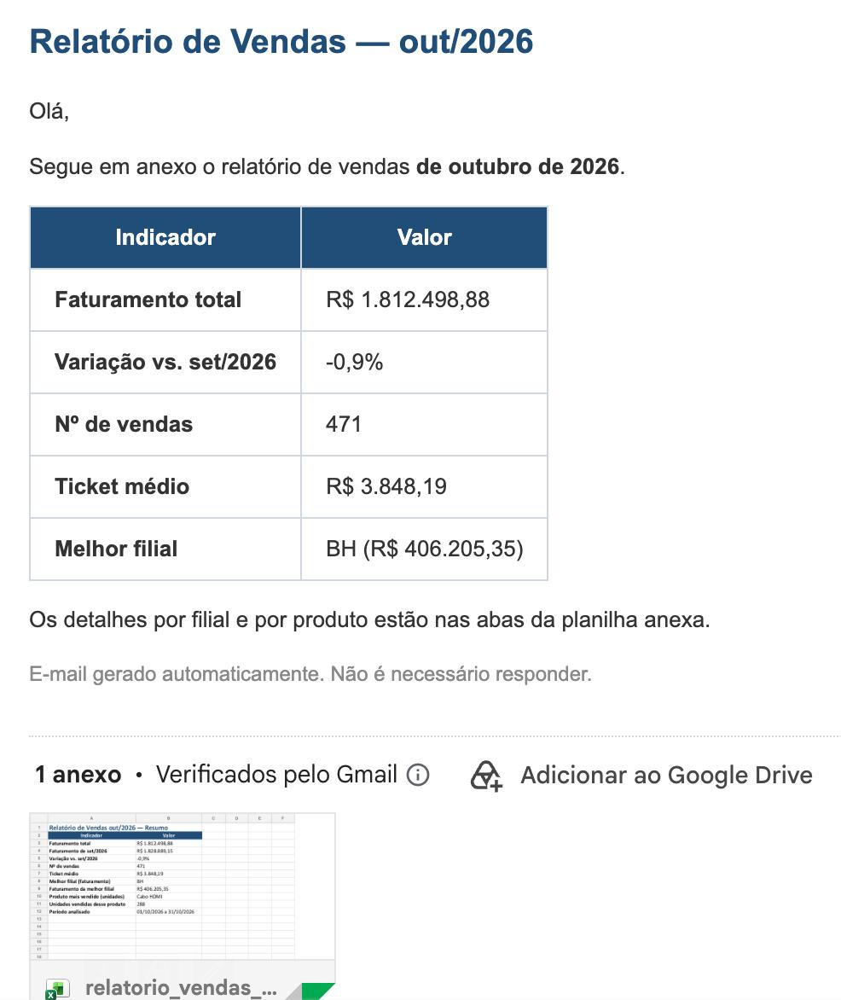
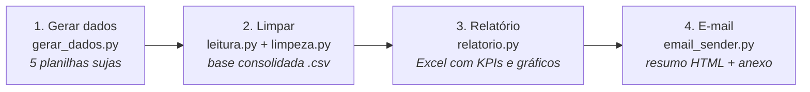
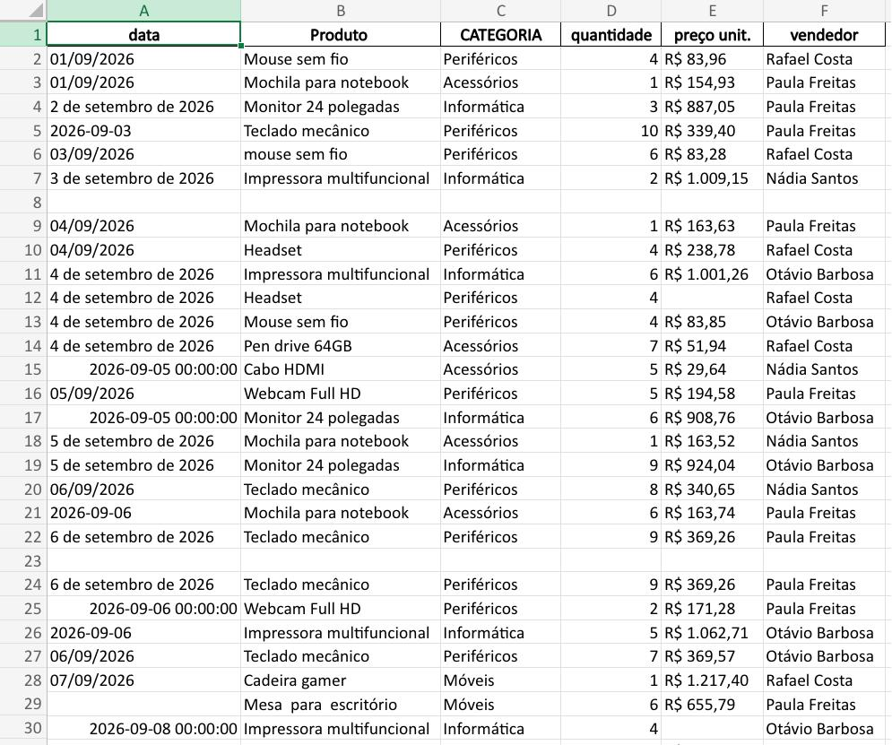
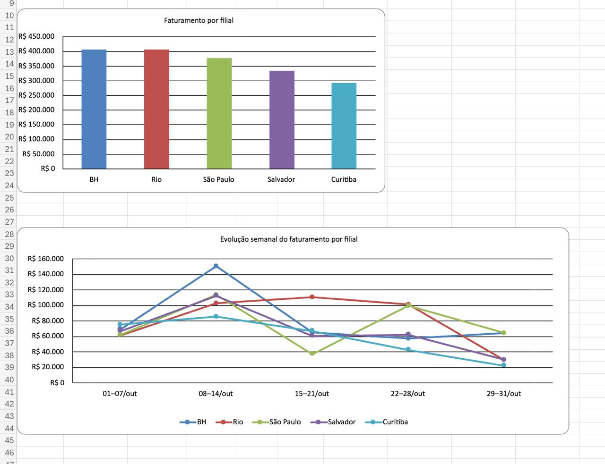

# Automação de Relatórios de Vendas

[](https://github.com/guilhermevidalg/automacao-relatorios/actions/workflows/relatorio-mensal.yml)

Pipeline em Python que transforma planilhas de vendas bagunçadas de 5 filiais em
um relatório mensal pronto: limpa e consolida os dados, gera um Excel com KPIs,
gráficos e comparação com o mês anterior, e monta o e-mail para o gestor. Roda
automaticamente todo mês via GitHub Actions, e só gera o resultado se os 118
testes automatizados passarem.



---

## O problema

Todo mês, cada uma das 5 filiais (Rio, São Paulo, BH, Curitiba e Salvador) manda
sua planilha de vendas, e cada uma vem de um jeito:

- datas em formatos diferentes (`01/09/2026`, `2026-09-03`, `3 de setembro de 2026`, número serial do Excel)
- preços como texto (`"R$ 1.009,15"`) em vez de número
- nomes de colunas diferentes (`Produto`, `CATEGORIA`, `preço unit.`) e cabeçalho fora da primeira linha
- linhas vazias, linhas duplicadas, produtos escritos de formas diferentes (`mouse sem fio` / `Mouse sem fio`)
- campos faltando (data, preço, vendedor)

Juntar isso à mão, corrigir, calcular os indicadores e montar o e-mail para o
gestor é um trabalho repetitivo, lento e fácil de errar.

## A solução

Um pipeline em 4 etapas, rodado pelo `main.py`:



1. **Gerar dados**: como é um projeto de portfólio, as planilhas são fictícias,
   geradas com problemas de qualidade diferentes em cada filial (em um sistema
   real, essa etapa seria a chegada dos arquivos).
2. **Limpar**: encontra o cabeçalho, padroniza nomes de colunas, converte datas
   e preços, corrige textos, trata faltantes, remove duplicatas e registra tudo
   em log.
3. **Relatório**: gera um Excel com abas Resumo (KPIs e comparação com o mês
   anterior), Por filial, Por produto e Base consolidada, com gráficos nativos.
4. **E-mail**: envia o relatório anexado pelo Gmail, com os principais
   indicadores no corpo do e-mail.

## Resultados

**Antes:** a planilha como chega da filial (datas misturadas, linhas vazias,
duplicatas, preços como texto, campos em branco).



**O relatório:** gráficos de faturamento por filial e evolução semanal do mês,
dentro do próprio Excel.



**A entrega:** o e-mail que o gestor recebe (imagem no topo desta página), com
faturamento, variação em relação ao mês anterior, número de vendas, ticket médio
e melhor filial.

## Antes vs. depois em números

Números tirados do `logs/limpeza.log` de execuções do pipeline:

| O que foi tratado | Ano de 2026 (modo anual) | Outubro/2026 (modo mensal) |
|---|---:|---:|
| Linhas lidas (5 planilhas) | 1.534 | 520 |
| Linhas vazias removidas | 13 | 13 |
| Linhas sem dado obrigatório removidas | 91 | 30 |
| Duplicatas removidas | 16 | 6 |
| **Linhas na base limpa** | **1.414** | **471** |
| Datas convertidas de texto | 1.128 | 379 |
| Preços convertidos de `"R$ 1.234,56"` para número | 885 | 295 |
| Nomes de produto corrigidos (espaços/maiúsculas) | 257 | 82 |
| Categorias preenchidas a partir do produto | 19 | 7 |
| Vendedores vazios → `"Não informado"` | 19 | 7 |
| Tempo do pipeline completo (sem o envio) | — | ~0,2 s |

## Como rodar

Requisitos: Python 3.9 ou mais recente (testado com Python 3.9 e 3.12).

```bash
# 1. Clonar e entrar na pasta
git clone https://github.com/guilhermevidalg/automacao-relatorios.git
cd automacao-relatorios

# 2. Criar o ambiente virtual e instalar as dependências
python3 -m venv .venv
source .venv/bin/activate        # no Windows: .venv\Scripts\activate
pip install -r requirements.txt

# 3. Configurar o e-mail (só necessário para o envio real)
cp .env.example .env
```

No `.env`, preencha:

- `GMAIL_REMETENTE`: a conta do Gmail que envia
- `GMAIL_SENHA_APP`: uma **senha de app** de 16 letras, não a senha normal
  ([como gerar uma senha de app no Gmail](https://support.google.com/accounts/answer/185833);
  exige verificação em duas etapas)
- `EMAIL_DESTINATARIOS`: quem recebe, separados por vírgula

O `.env` está no `.gitignore` e nunca vai para o GitHub.

### Comandos

```bash
python main.py                          # mês anterior ao atual, com envio do e-mail
python main.py --mes 2026-10            # um mês específico (formato AAAA-MM), com envio
python main.py --mes 2026-10 --dry-run  # tudo, mas o e-mail só em prévia (não envia, não precisa de .env)
python main.py --mes 2026-10 --sem-email  # para no relatório (não precisa de .env)
python main.py --help                   # lista as opções
```

Para ver tudo funcionando sem configurar o Gmail, use `--dry-run` ou `--sem-email`.
Sem `.env`, a prévia usa endereços de exemplo (`@example.com`). Os arquivos
gerados ficam em:

- `data/raw/2026-10/`: planilhas sujas das filiais
- `data/processed/vendas_2026-10.csv`: base limpa
- `output/relatorio_vendas_2026-10.xlsx`: relatório
- `output/previa_email.html`: prévia do e-mail (com `--dry-run`)
- `logs/limpeza.log` e `logs/pipeline.log`: o que foi feito em cada etapa

A comparação com o mês anterior só aparece se o mês anterior também já tiver
sido processado. Por exemplo, rode `--mes 2026-09` antes de `--mes 2026-10`.

Cada etapa também pode rodar sozinha (sem `--mes`, processa o ano de 2026 inteiro):

```bash
python src/gerar_dados.py
python src/limpeza.py
python src/relatorio.py
python src/email_sender.py --dry-run
```

## Agendamento automático (GitHub Actions)

O workflow [`.github/workflows/relatorio-mensal.yml`](.github/workflows/relatorio-mensal.yml)
roda o pipeline sozinho, na nuvem do GitHub, **todo dia 1º às 8h de Brasília**
(11h UTC), para o mês que acabou de fechar. O badge no topo desta página mostra
se a última execução deu certo.

Cada execução:

1. instala as dependências e roda os testes (se algum falhar, para por aí);
2. processa o mês anterior, só para ter a base da comparação (a máquina da nuvem
   começa vazia a cada execução);
3. roda `main.py --dry-run` para o mês do relatório;
4. salva como *artifact* o relatório `.xlsx`, a prévia do e-mail (`previa_email.html`)
   e os logs.

**Onde baixar:** aba **Actions** → **Relatório mensal** → clique na execução → no
fim da página, em *Artifacts*, baixe `relatorio-AAAA-MM`.

**Rodar manualmente:** aba **Actions** → **Relatório mensal** → **Run workflow**.
O campo `mes` é opcional: vazio gera o mês anterior; preenchido (ex.: `2026-10`),
gera aquele mês. Pelo terminal, com o [GitHub CLI](https://cli.github.com/):

```bash
gh workflow run relatorio-mensal.yml -f mes=2026-10
```

**Sem credenciais na nuvem:** o workflow roda **sempre em `--dry-run`**, então
nenhum e-mail é enviado e nenhum *Secret* (senha ou endereço) fica cadastrado no
GitHub. A prévia usa endereços de exemplo (`remetente@example.com`). O envio real
é feito localmente, com o `.env`: `python main.py`.

## Estrutura de pastas

```
automacao-relatorios/
├── .github/workflows/
│   └── relatorio-mensal.yml  # agendamento mensal no GitHub Actions (sempre --dry-run)
├── main.py               # pipeline mensal: roda as 4 etapas em ordem para um mês
├── src/
│   ├── gerar_dados.py    # gera as planilhas fictícias e sujas de cada filial
│   ├── leitura.py        # acha o cabeçalho, padroniza nomes de colunas e junta as planilhas
│   ├── limpeza.py        # converte tipos, trata faltantes e duplicatas, salva a base limpa
│   ├── relatorio.py      # calcula os KPIs (pandas) e monta o Excel com gráficos (openpyxl)
│   ├── email_sender.py   # monta o e-mail em HTML e envia pelo Gmail
│   └── periodo.py        # funções de mês (validar, mês anterior, nomes) e caminhos dos arquivos
├── tests/
│   ├── test_email_sender.py  # configuração do e-mail: prévia sem .env e envio real exigindo tudo
│   ├── test_leitura.py   # cabeçalho, nomes de colunas e nome da filial
│   ├── test_limpeza.py   # datas, preços, textos, faltantes, duplicatas e filtro do mês
│   └── test_periodo.py   # validação de mês, mês anterior, variação e rótulos das semanas
├── docs/img/             # imagens usadas neste README
├── .env.example          # modelo das configurações de e-mail (sem valores reais)
├── requirements.txt      # dependências do projeto
├── pytest.ini            # configuração do pytest
│
│   Gerados ao rodar (fora do Git):
├── data/raw/             # planilhas sujas
├── data/processed/       # bases limpas em CSV
├── output/               # relatórios Excel e prévia do e-mail
└── logs/                 # logs da limpeza e do pipeline
```

## Decisões técnicas

- **Estratégia mista para valores faltantes**: sem data, produto, quantidade ou
  preço não dá para calcular o faturamento, então a linha é removida. Categoria
  vazia é preenchida com a categoria mais comum do mesmo produto, e vendedor
  vazio vira `"Não informado"` (a venda continua valendo).
- **Datas com formatos explícitos**: cada formato aceito é tratado no código, e o
  pandas nunca "adivinha", para não trocar dia com mês (`03/09` é sempre 3 de setembro).
- **Duplicatas removidas depois da padronização**: assim também são pegas as
  "quase duplicatas", que só diferem em espaços, maiúsculas ou formato da data.
- **Valores gravados como número, com formato `R$`**: no Excel, os valores são
  números de verdade (dá para somar e filtrar), exibidos como `R$ 1.234,56` pelo
  formato da célula.
- **Gráficos nativos do Excel** (`openpyxl.chart`) em vez de imagens: quem recebe
  pode clicar, ver os valores e reaproveitar o gráfico.
- **"Sem comparação" em vez de inventar o mês anterior**: a variação só é
  calculada se a base do mês anterior existir. Caso contrário, o relatório diz
  "sem comparação" e o log registra um aviso, sem gerar dados que não existem.
- **Seed reproduzível por mês**: os dados fictícios usam a semente
  `[ano, mês, filial]`, então o mesmo mês gera sempre as mesmas planilhas, e
  meses diferentes nunca se repetem.
- **Credenciais fora do código**: remetente, senha de app e destinatários ficam
  no `.env` (lido com `python-dotenv`); no repositório só existe o modelo
  `.env.example`. Cada erro de configuração ou envio tem uma mensagem clara.
- **Agendamento sem segredos**: na nuvem o pipeline roda sempre em `--dry-run`,
  sem nenhum *Secret* cadastrado. O mês digitado no gatilho manual é validado e
  passado por variável de ambiente, nunca colado direto no comando.

## Testes

São 118 testes com `pytest`, rodados também a cada execução do GitHub Actions.
A maioria cobre as regras de limpeza, onde um erro passaria despercebido no
relatório; os demais cobrem o cálculo de períodos e a configuração do e-mail:

- **Datas**: todos os formatos aceitos, datas inválidas e o caso dia/mês que não pode ser invertido
- **Preços**: `"R$ 1.234,56"` → `1234.56` e valores inválidos
- **Textos**: espaços extras e grafia mais frequente (sem estragar nomes como "Pen drive 64GB")
- **Faltantes**: remoção por campo obrigatório e preenchimento de categoria e vendedor
- **Duplicatas**: exatas e quase duplicatas
- **Leitura**: cabeçalho em qualquer linha e todo nome de coluna usado pelas filiais é reconhecido
- **Período**: validação de `AAAA-MM`, mês anterior na virada do ano, variação percentual e rótulos das semanas
- **E-mail**: prévia funciona sem `.env` (endereços de exemplo); envio real exige `.env` completo

```bash
python -m pytest -v
```

## Tecnologias

- **Python 3.9+**
- **pandas**: leitura, limpeza e cálculos
- **openpyxl**: escrita do Excel, formatação e gráficos nativos
- **smtplib + email** (biblioteca padrão): envio pelo Gmail com SSL
- **python-dotenv**: leitura das credenciais do `.env`
- **logging** (biblioteca padrão): logs de cada etapa
- **pytest**: testes automatizados
- **GitHub Actions**: agendamento mensal na nuvem e download dos resultados
- **Mermaid**: diagrama do pipeline neste README

## Próximos passos

- **Variação colorida**: verde para alta e vermelho para queda, no Excel e no e-mail
- **Semana incompleta destacada**: marcar no gráfico semanal o bloco final do mês
  (ex.: 29–31), que tem menos dias e parece uma queda
- **Relatório em PDF**: anexar também uma versão em PDF para leitura no celular
